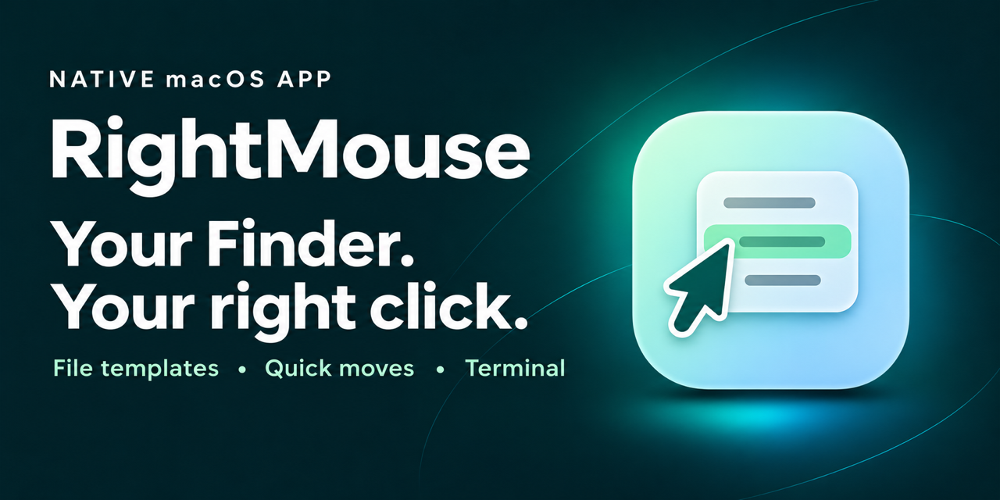

# RightMouse

[简体中文](README.md) · English

Make Finder’s right click yours. Create files, organize them, copy paths, and open Terminal from the context menu.

[Website](https://echo-braveshine.github.io/RightMouse/en.html) · [Download](https://github.com/Echo-BraveShine/RightMouse/releases) · [Report an Issue](https://github.com/Echo-BraveShine/RightMouse/issues) · [Buy Me a Coffee](https://buymeacoffee.com/1239383708p)

**macOS 13+ · Apple silicon and Intel · English / 简体中文**

## Features

| Action | What it does |
| --- | --- |
| New File | Right-click a folder’s background to create a file from a template. Import and rename multiple templates per extension. The menu shows `extension(template name)`. |
| Move to and Copy to | Send selected items to a favorite folder or choose a destination for this operation. |
| Favorite Folders | Open frequently used folders from the context menu. |
| Copy Path | Copy selected paths, one per line, or right-click the background to copy the current folder path. |
| Open in Terminal | Open macOS Terminal in the current folder, a selected folder, or a file’s containing folder. |
| Menu and appearance | Reorder and toggle actions. Choose a language and appearance manually in General or follow macOS. Liquid Glass is available on macOS 26 and later. |

## Install

### Direct download

Download the latest universal ZIP from [GitHub Releases](https://github.com/Echo-BraveShine/RightMouse/releases), unzip it, and drag `RightMouse.app` into Applications.

### Homebrew

Install the released app from the RightMouse Homebrew tap:

```sh
brew tap echo-braveshine/rightmouse https://github.com/Echo-BraveShine/RightMouse.git
brew install --cask echo-braveshine/rightmouse/rightmouse
```

## Get started

1. Open RightMouse, go to General, and click Extension Settings. Enable the RightMouse Finder extension in macOS System Settings.
2. Open a folder in Finder, right-click its background, and choose New File. Select a file to try Copy to and Move to.
3. Use Context Menu, Favorite Folders, and File Templates in RightMouse to set up the actions, folders, and templates you use most.

If macOS asks for access to Desktop, Documents, Downloads, or another folder, grant access as needed. The Finder menu also appears on mounted volumes, where file actions depend on the location’s permissions.

## Update

- **In the app**: Open General → Version & Support → Check for Updates. When an update is available, install it in the app and relaunch.
- **With Homebrew**: If you installed RightMouse with Homebrew, you can also run:

```sh
brew upgrade --cask --greedy echo-braveshine/rightmouse/rightmouse
```

[Build and release guide](RELEASING.md)

If RightMouse helps you, you can [buy me a coffee](https://buymeacoffee.com/1239383708p) to support its development.


