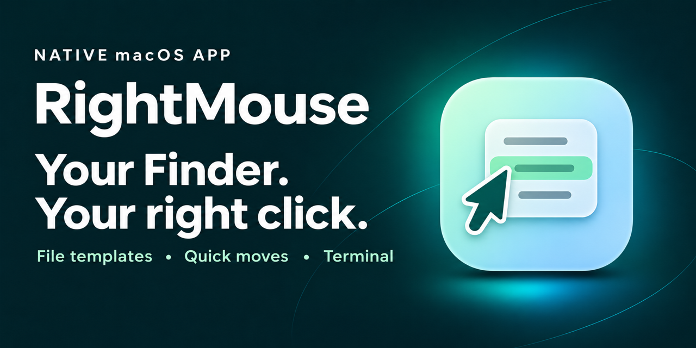

# RightMouse

简体中文 · [English](README.en.md)

让访达右键更顺手。在当前目录新建文件、快速归档、复制路径，或直接打开终端。

[官网](https://echo-braveshine.github.io/RightMouse/) · [下载](https://github.com/Echo-BraveShine/RightMouse/releases) · [问题反馈](https://github.com/Echo-BraveShine/RightMouse/issues) · [请我喝杯咖啡](https://buymeacoffee.com/1239383708p)

**macOS 13+ · Apple 芯片与 Intel · 简体中文 / English**

## 功能

| 功能 | 用法 |
| --- | --- |
| 新建文件 | 在文件夹空白处右键，从模板新建文件。支持为同一后缀导入多个模板并重命名，菜单显示为 `后缀(模板名)`。 |
| 移动到、复制到 | 批量归档到常用目录，或临时选择目标文件夹。 |
| 常用目录 | 从右键菜单打开常用文件夹。 |
| 复制路径 | 选中项目时复制其路径，多选时每行一个。空白处右键可复制当前文件夹路径。 |
| 在终端中打开 | 从当前目录、所选文件夹或文件所在目录打开系统终端。 |
| 菜单与外观 | 拖动排序，自定义显示项，语言与外观都可以跟随系统，也可手动选择。macOS 26+ 支持液态玻璃。 |

## 安装

### 直接下载

从 [GitHub Releases](https://github.com/Echo-BraveShine/RightMouse/releases) 下载最新的通用版 ZIP，解压后将 `RightMouse.app` 拖到「应用程序」。

### 使用 Homebrew

发布版可通过 RightMouse 的 Homebrew tap 安装：

```sh
brew tap echo-braveshine/rightmouse https://github.com/Echo-BraveShine/RightMouse.git
brew install --cask echo-braveshine/rightmouse/rightmouse
```

## 第一次使用

1. 打开 RightMouse，在「通用」中点「扩展设置」，然后在 macOS 系统设置里启用 RightMouse 的访达扩展。
2. 在访达打开一个文件夹，右键点击空白处，选择「新建文件」。选中文件后可试用「复制到」和「移动到」。
3. 在 RightMouse 的「右键菜单」「常用目录」和「文件模板」中，自定义平时要用的命令、目录和模板。

如果 macOS 提示访问桌面、文稿、下载或其他文件夹，请根据需要授权。访达菜单也可在挂载卷中使用，文件操作取决于该位置的权限。

## 更新

- **在 App 内更新**：打开「通用 → 版本与支持 → 检查更新」。有新版时，可以在 App 内下载、安装并重新启动。
- **使用 Homebrew 更新**：如果通过 Homebrew 安装，也可以运行：

```sh
brew upgrade --cask --greedy echo-braveshine/rightmouse/rightmouse
```

[构建与发布说明](RELEASING.md)

如果 RightMouse 对你有帮助，欢迎 [请我喝杯咖啡](https://buymeacoffee.com/1239383708p)，支持后续开发。


